# My Homelab

Selbst gehostete Kubernetes-Infrastruktur auf **zwei Nodes** – vollständig per **GitOps** verwaltet.
Ein Raspberry Pi bildet die Control Plane, ein Homeserver mit NVIDIA-GPU führt die Workloads aus.
Von aussen ist alles über **Cloudflare Zero Trust** erreichbar, im Cluster verteilt **Traefik** die Anfragen.

| Bereich | Stand |
| --- | --- |
| **Cluster** | k3s v1.34 · 2 Nodes (arm64 + x86_64) |
| **GitOps** | ArgoCD v3.3 · App of Apps · ApplicationSet · AppProjects |
| **Zugriff** | Cloudflare Tunnel + Access → Traefik → `*.janikhenz.ch` |
| **GPU** | NVIDIA GTX 1060 (6 GB) · Time-Slicing für Jellyfin & Ollama |
| **Storage** | hostPath-Volumes unter `/mnt/data` (Retain) |
| **Stacks** | Media · KI (Jarvis) · Monitoring · Smart Home · Cloud · Passwörter · Gaming · Sync |

---

## Inhalt

1. [Überblick](#überblick)
2. [Architektur](#architektur)
3. [GitOps](#gitops)
4. [Stacks](#stacks) – [Media](#media) · [Jarvis (KI)](#jarvis-ki) · [Monitoring](#monitoring) · [Weitere Apps](#weitere-apps) · [Pterodactyl](#pterodactyl) · [Dashboard](#dashboard)
5. [Infrastruktur](#infrastruktur) – [Storage](#storage) · [NVIDIA GPU](#nvidia-gpu) · [Secrets](#secrets)
6. [Netzwerk & Ports](#netzwerk--ports)
7. [Betrieb](#betrieb)
8. [Screenshots](#screenshots)
9. [Verzeichnisstruktur](#verzeichnisstruktur)
10. [TODO](#todo)

---

## Überblick

### Stacks

| Stack | Namespace | Apps | Node |
| --- | --- | --- | --- |
| Media | `media` | Jellyfin, Plex, Jellyseerr, Sonarr, Radarr, Prowlarr, qBittorrent, FlareSolverr | Homeserver |
| Jarvis (KI) | `jarvis` | Ollama, LibreChat (+ MongoDB, Meilisearch), Whisper, Piper, ChromaDB | Homeserver |
| Monitoring | `monitoring` | Prometheus, Grafana, node-exporter, dcgm-exporter | Homeserver |
| Smart Home | `home-assistant` | Home Assistant | Homeserver |
| Cloud | `nextcloud` | Nextcloud (+ MariaDB) | Homeserver |
| Passwörter | `vaultwarden` | Vaultwarden | Raspberry Pi |
| Gaming | `gaming` | Pterodactyl Panel (+ MariaDB), Wings | Homeserver |
| Sync | `syncthing` | Syncthing (Obsidian-Vault) | Homeserver |
| Lernen & Ziele | `bethegoat` | BeTheGoat Lern-Hub (eigenes Image) | Homeserver |
| Startseite | `default` | Dashboard | Raspberry Pi |

### Hardware

| Node | Rolle | Hardware | OS | Läuft dort |
| --- | --- | --- | --- | --- |
| `raspberrypi` · 192.168.1.10 | Control Plane | Raspberry Pi 4 · 4 Kerne · 8 GB · SD-Karte | Debian 12 | k3s-Server, ArgoCD, Traefik, cloudflared, Dashboard, Vaultwarden |
| `homeserver` · 192.168.1.9 | Worker | x86_64 · 8 Kerne · 16 GB · GTX 1060 6 GB | Ubuntu 24.04 | alle übrigen Workloads |

> **Wichtig:** Der Raspberry Pi 4 braucht ein Netzteil mit **5,1 V / 3 A**. Mit einem schwächeren
> Netzteil startet er unter Last (z. B. bei ArgoCD-Syncs) ohne Fehlermeldung neu.

---

## Architektur

<p align="center">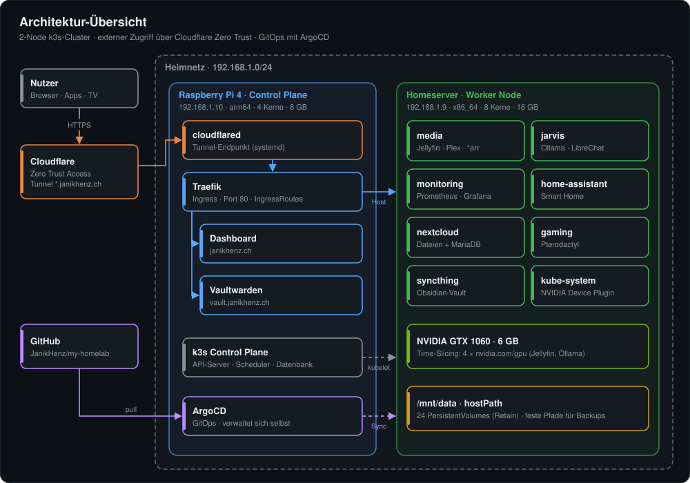</p>

**So kommt eine Anfrage an:**

1. Der Browser ruft z. B. `https://jellyfin.janikhenz.ch` auf.
2. **Cloudflare Access** prüft die Anmeldung (Zero Trust).
3. Der **Cloudflare Tunnel** bringt die Anfrage zu `cloudflared` auf dem Pi. Der Tunnel wird
   von innen nach aussen aufgebaut – im Router ist keine Portfreigabe nötig.
4. `cloudflared` leitet alles (`*.janikhenz.ch`) an **Traefik** auf Port 80 weiter.
5. Traefik wählt anhand des Hostnamens die passende `IngressRoute` und den Service.

**Im Heimnetz** sind einzelne Dienste zusätzlich direkt per `IP:NodePort` erreichbar – nur dort, wo
es nötig ist (siehe [Netzwerk & Ports](#netzwerk--ports)).

---

## GitOps

<p align="center">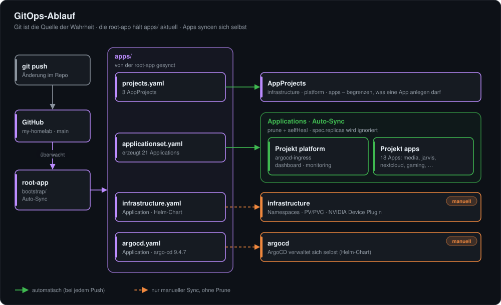</p>

Alles im Cluster ist in diesem Repo beschrieben. Die einzige Ressource, die von Hand angelegt wird,
ist die `root-app` (`kubectl apply -f bootstrap/root-app.yaml`) – sie verwaltet alles Weitere.

### Schichten

| Ordner | Inhalt | Verwaltet durch |
| --- | --- | --- |
| `bootstrap/` | `root-app` (App of Apps) | von Hand, einmalig |
| `apps/` | AppProjects, ApplicationSet, Applications `infrastructure` und `argocd` | `root-app` |
| `infrastructure/` | Helm-Chart: Namespaces, PersistentVolumes/Claims, NVIDIA Device Plugin | Application `infrastructure` |
| `manifests/` | Manifeste der Apps, ein Ordner pro App | ApplicationSet `homelab-apps` |

### Sync-Regeln

| Application | Sync | Warum |
| --- | --- | --- |
| `root-app` | automatisch · prune · selfHeal | hält `apps/` aktuell |
| 22 App-Applications | automatisch · prune · selfHeal | Git ist die Wahrheit. `spec.replicas` wird ignoriert, damit Skalieren übers Dashboard bestehen bleibt |
| `infrastructure` | **manuell, immer ohne Prune** | Speicher und Namespaces nie automatisch ändern |
| `argocd` | **manuell** | ArgoCD verwaltet sich selbst – Änderungen erst nach Prüfung des Diffs |

### AppProjects

| Projekt | Applications | Darf clusterweit anlegen |
| --- | --- | --- |
| `infrastructure` | infrastructure | Namespace, PersistentVolume, RuntimeClass |
| `platform` | argocd, argocd-ingress, dashboard, monitoring | ClusterRole, ClusterRoleBinding, CRDs |
| `apps` | die übrigen 19 Apps | nichts – nur Ressourcen in den eigenen Namespaces |

### Neue App hinzufügen

1. Manifeste unter `manifests/<app>/` anlegen – mit `namespace:` in jedem Objekt.
2. Speicher nötig? → Eintrag in `infrastructure/values.yaml` unter `volumes:`.
   Neuer Namespace? → in `infrastructure/values.yaml` unter `namespaces:` **und** in `apps/projects.yaml` (Projekt `apps`).
   Danach die Application `infrastructure` von Hand syncen (ohne Prune).
3. Eine Zeile in `apps/applicationset.yaml` unter `elements:` ergänzen.
4. Commit + Push – die App erscheint in ArgoCD und wird automatisch deployt.

---

## Stacks

### Media

<p align="center">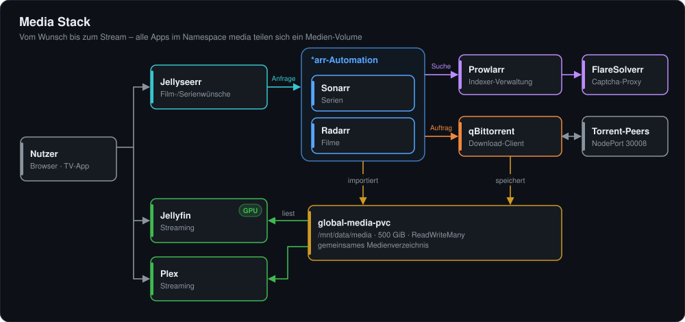</p>

Jellyseerr nimmt Wünsche entgegen, Sonarr (Serien) und Radarr (Filme) suchen über Prowlarr und
laden mit qBittorrent. Alle Apps teilen sich das Volume `global-media-pvc` – Jellyfin und Plex
streamen direkt von dort.

| App | Zweck | Image | Port | URL | NodePort |
| --- | --- | --- | --- | --- | --- |
| Jellyfin | Streaming (GPU-Transcoding) | `jellyfin/jellyfin:latest` | 8096 | `jellyfin.janikhenz.ch` | 30001 |
| Plex | Streaming | `plexinc/pms-docker:latest` | 32400 | `plex.janikhenz.ch` | 30002 |
| Jellyseerr | Wünsche | `ghcr.io/seerr-team/seerr:latest` | 5055 | `jellyseerr.janikhenz.ch` | – |
| Sonarr | Serien | `linuxserver/sonarr:latest` | 8989 | `sonarr.janikhenz.ch` | – |
| Radarr | Filme | `linuxserver/radarr:latest` | 7878 | `radarr.janikhenz.ch` | – |
| Prowlarr | Indexer | `linuxserver/prowlarr:latest` | 9696 | `prowlarr.janikhenz.ch` | – |
| qBittorrent | Downloads | `linuxserver/qbittorrent:latest` | 8080 / 6881 | `qbt.janikhenz.ch` | 30008 (Peers) |
| FlareSolverr | Captcha-Proxy für Prowlarr | `ghcr.io/flaresolverr/flaresolverr:latest` | 8191 | intern | – |

### Jarvis (KI)

<p align="center">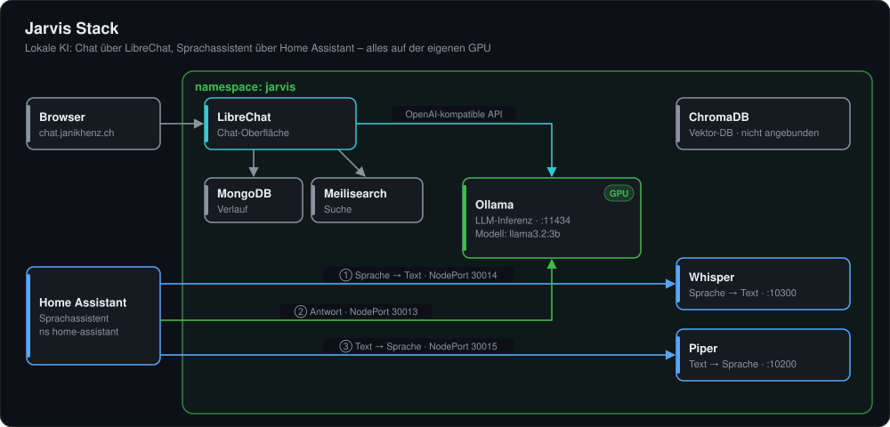</p>

Lokale KI ohne Cloud: **LibreChat** ist die Chat-Oberfläche für **Ollama**. Der Sprachassistent von
**Home Assistant** nutzt Whisper (Sprache → Text), Ollama (Antwort) und Piper (Text → Sprache).

| App | Zweck | Image | Port | URL | NodePort |
| --- | --- | --- | --- | --- | --- |
| Ollama | LLM-Inferenz (GPU) | `ollama/ollama:latest` | 11434 | `ollama.janikhenz.ch` | 30013 |
| LibreChat | Chat-Oberfläche | `ghcr.io/danny-avila/librechat:latest` | 3080 | `chat.janikhenz.ch` | – |
| MongoDB | LibreChat-Daten | `mongo:8.0.20` | 27017 | intern | – |
| Meilisearch | LibreChat-Suche | `getmeili/meilisearch:v1.35.1` | 7700 | intern | – |
| Whisper | Spracherkennung (Wyoming) | `rhasspy/wyoming-whisper:latest` | 10300 | – | 30014 |
| Piper | Sprachausgabe (Wyoming) | `rhasspy/wyoming-piper:latest` | 10200 | – | 30015 |
| ChromaDB | Vektor-DB (noch nicht angebunden) | `chromadb/chroma:latest` | 8000 | intern | – |

### Monitoring

Prometheus sammelt Cluster-, Host-, Container- und GPU-Metriken (Aufbewahrung 30 Tage), Grafana stellt sie dar.
Alle Metriken tragen das Label `cluster="homelab"` (wird von den Kubernetes-Dashboards benötigt).

| Komponente | Zweck | Image | Port | URL |
| --- | --- | --- | --- | --- |
| Prometheus | Metriken | `prom/prometheus:latest` | 9090 | `prometheus.janikhenz.ch` |
| Grafana | Dashboards | `grafana/grafana:latest` | 3000 | `grafana.janikhenz.ch` |
| node-exporter | Host-Metriken (DaemonSet, beide Nodes) | `prom/node-exporter:latest` | 9100 | intern |
| dcgm-exporter | GPU-Metriken (DaemonSet, Homeserver) | `nvcr.io/nvidia/k8s/dcgm-exporter:3.3.7-3.5.0-ubuntu22.04` | 9400 | intern |
| kube-state-metrics | Zustand der Kubernetes-Objekte (Pods, Neustarts, Replicas) | `registry.k8s.io/kube-state-metrics/kube-state-metrics:v2.18.0` | 8080 | intern |
| cAdvisor (im kubelet) | CPU/RAM pro Container | – | – | intern |

**Dashboards** (Ordner *Homelab*, als ConfigMaps `manifests/monitoring/grafana-dashboard-*.yaml` im Repo):

| Dashboard | Quelle | Zeigt |
| --- | --- | --- |
| Node Exporter Full | [grafana.com 1860](https://grafana.com/grafana/dashboards/1860) | CPU, RAM, Disks, Netzwerk, Temperaturen pro Node |
| NVIDIA DCGM Exporter | [grafana.com 12239](https://grafana.com/grafana/dashboards/12239) | GPU-Auslastung, VRAM, Temperatur, Strom |
| Kubernetes / Views / Global | [grafana.com 15757](https://grafana.com/grafana/dashboards/15757) | Cluster-Überblick: Ressourcen, Pods, Namespaces |
| Kubernetes / Views / Namespaces | [grafana.com 15758](https://grafana.com/grafana/dashboards/15758) | CPU/RAM/Netzwerk pro Namespace |
| Kubernetes / Views / Nodes | [grafana.com 15759](https://grafana.com/grafana/dashboards/15759) | Pods und Auslastung pro Node |
| Kubernetes / Views / Pods | [grafana.com 15760](https://grafana.com/grafana/dashboards/15760) | Status, Neustarts, Ressourcen pro Pod |

> kube-state-metrics hat bewusst **keinen Zugriff auf Secrets**. Die Kachel „Secrets“ im Global-Dashboard bleibt deshalb leer.

### Weitere Apps

| App | Zweck | Image | Node | URL | NodePort |
| --- | --- | --- | --- | --- | --- |
| Home Assistant | Smart Home | `ghcr.io/home-assistant/home-assistant:latest` | Homeserver | `homeassistant.janikhenz.ch` | 30009 |
| Nextcloud | Dateiablage | `nextcloud:35.0.2` + `mariadb:10.11` | Homeserver | `nextcloud.janikhenz.ch` | – |
| Vaultwarden | Passwort-Manager (Bitwarden-kompatibel) | `vaultwarden/server:latest` | Raspberry Pi | `vault.janikhenz.ch` | – |
| Syncthing | Sync des Obsidian-Vaults | `syncthing/syncthing:latest` | Homeserver | `syncthing.janikhenz.ch` | 30200, 30227 |
| BeTheGoat | Lernplan, Zusammenfassungen, Ernährung, Tagesablauf | `ghcr.io/janikhenz/bethegoat:latest` (privat) | Homeserver | `bethegoat.janikhenz.ch` | – |

### Pterodactyl

<p align="center">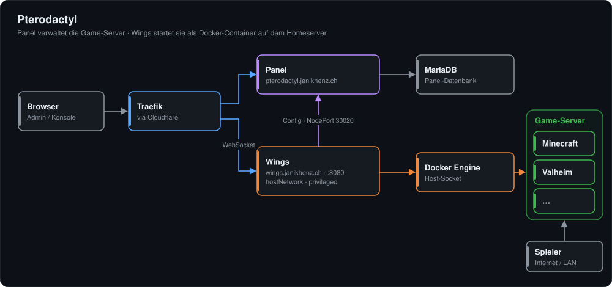</p>

Game-Server-Verwaltung: Das **Panel** ist die Weboberfläche, **Wings** startet die Game-Server als
Docker-Container direkt auf dem Homeserver (`hostNetwork`, `privileged`, Docker-Socket).

| Komponente | Image | Port | URL | NodePort |
| --- | --- | --- | --- | --- |
| Panel | `ghcr.io/pterodactyl/panel:v1.12.4` | 80 | `pterodactyl.janikhenz.ch` | 30020 (für Wings) |
| MariaDB | `mariadb:10.11` | 3306 | intern | – |
| Wings | `ghcr.io/pterodactyl/wings:v1.11.13` | 8080 | `wings.janikhenz.ch` | Host-Netzwerk |

**Wings einrichten** (einmalig, nach dem ersten Start des Panels):

1. Im Panel unter *Admin → Nodes* einen Node anlegen (FQDN `wings.janikhenz.ch`).
2. Die erzeugte `config.yml` nach `/mnt/data/pterodactyl/wings/config/config.yml` auf dem Homeserver legen.
   Als `remote` muss dort `http://192.168.1.9:30020` stehen – Wings erreicht das Panel über den NodePort.
3. `kubectl -n gaming rollout restart deployment/pterodactyl-wings`

### Dashboard

<p align="center">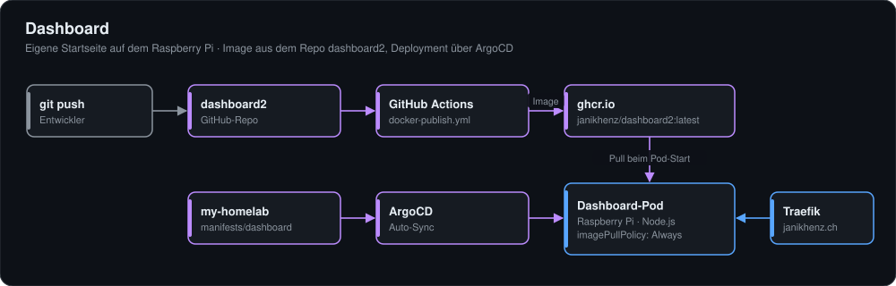</p>

Die Startseite `janikhenz.ch` (Repo [JanikHenz/dashboard2](https://github.com/JanikHenz/dashboard2))
zeigt den Zustand der Apps und kann sie über die Kubernetes-API skalieren.

| Eigenschaft | Wert |
| --- | --- |
| Image | `ghcr.io/janikhenz/dashboard2:latest` (gebaut von GitHub Actions) |
| Node | Raspberry Pi |
| Rechte | ServiceAccount `dashboard-reader` + ClusterRole `dashboard-deployments-manager` (lesen, skalieren) |
| Update | Neues Image wird beim nächsten Pod-Start gezogen (`imagePullPolicy: Always`) |

---

## Infrastruktur

Alles in diesem Abschnitt kommt aus dem Helm-Chart [`infrastructure/`](infrastructure/) und wird
**nur von Hand** gesynct.

### Storage

Alle Volumes sind feste `hostPath`-Ordner unter `/mnt/data` mit `persistentVolumeReclaimPolicy: Retain`.
Kubernetes löscht diese Daten nie – auch nicht, wenn PV oder PVC gelöscht werden. Die Pfade sind
fest und eignen sich damit gut für Backups. Neue Volumes: eine Zeile in `infrastructure/values.yaml`.

> `vaultwarden-data` liegt auf dem **Raspberry Pi** (dort läuft Vaultwarden), alle anderen Volumes auf dem **Homeserver**.

| PVC | Namespace | Grösse | Zugriff | Pfad | Genutzt von |
| --- | --- | --- | --- | --- | --- |
| `jellyfin-config-pvc` | `media` | 10 GiB | RWO | `/mnt/data/jellyfin/config` | Jellyfin |
| `plex-config-pvc` | `media` | 10 GiB | RWO | `/mnt/data/plex/config` | Plex |
| `radarr-config-pvc` | `media` | 1 GiB | RWO | `/mnt/data/radarr/config` | Radarr |
| `sonarr-config-pvc` | `media` | 1 GiB | RWO | `/mnt/data/sonarr/config` | Sonarr |
| `qbittorrent-config-pvc` | `media` | 1 GiB | RWO | `/mnt/data/qbittorrent/config` | qBittorrent |
| `prowlarr-config-pvc` | `media` | 1 GiB | RWO | `/mnt/data/prowlarr/config` | Prowlarr |
| `jellyseerr-config-pvc` | `media` | 5 GiB | RWO | `/mnt/data/jellyseerr/config` | Jellyseerr |
| `global-media-pvc` | `media` | 500 GiB | RWX | `/mnt/data/media` | Jellyfin, Plex, Radarr, Sonarr, qBittorrent |
| `chromadb-pvc` | `jarvis` | 5 GiB | RWO | `/mnt/data/chromadb` | ChromaDB |
| `ollama-config-pvc` | `jarvis` | 50 GiB | RWO | `/mnt/data/ollama/config` | Ollama (Modelle) |
| `librechat-data-pvc` | `jarvis` | 10 GiB | RWO | `/mnt/data/librechat/data` | LibreChat (Uploads, Logs) |
| `librechat-mongodb-pvc` | `jarvis` | 5 GiB | RWO | `/mnt/data/librechat/mongodb` | LibreChat MongoDB |
| `librechat-meilisearch-pvc` | `jarvis` | 2 GiB | RWO | `/mnt/data/librechat/meilisearch` | LibreChat Meilisearch |
| `prometheus-pvc` | `monitoring` | 10 GiB | RWO | `/mnt/data/prometheus` | Prometheus |
| `grafana-pvc` | `monitoring` | 2 GiB | RWO | `/mnt/data/grafana` | Grafana |
| `home-assistant-config-pvc` | `home-assistant` | 5 GiB | RWO | `/mnt/data/home-assistant/config` | Home Assistant |
| `nextcloud-data-pvc` | `nextcloud` | 100 GiB | RWO | `/mnt/data/nextcloud/data` | Nextcloud |
| `nextcloud-mariadb-pvc` | `nextcloud` | 10 GiB | RWO | `/mnt/data/nextcloud/database` | Nextcloud MariaDB |
| `vaultwarden-data-pvc` | `vaultwarden` | 1 GiB | RWO | `/mnt/data/vaultwarden/data` | Vaultwarden |
| `pterodactyl-panel-config-pvc` | `gaming` | 5 GiB | RWO | `/mnt/data/pterodactyl/panel/config` | Pterodactyl Panel |
| `pterodactyl-mariadb-pvc` | `gaming` | 10 GiB | RWO | `/mnt/data/pterodactyl/panel/database` | Pterodactyl MariaDB |
| `pterodactyl-wings-config-pvc` | `gaming` | 5 GiB | RWO | `/mnt/data/pterodactyl/wings/config` | Pterodactyl Wings |
| `pterodactyl-servers-pvc` | `gaming` | 100 GiB | RWX | `/mnt/data/pterodactyl/servers` | Game-Server (Panel + Wings) |
| `syncthing-data-pvc` | `syncthing` | 5 GiB | RWO | `/mnt/data/obsidian` | Syncthing / Obsidian |

### NVIDIA GPU

<p align="center">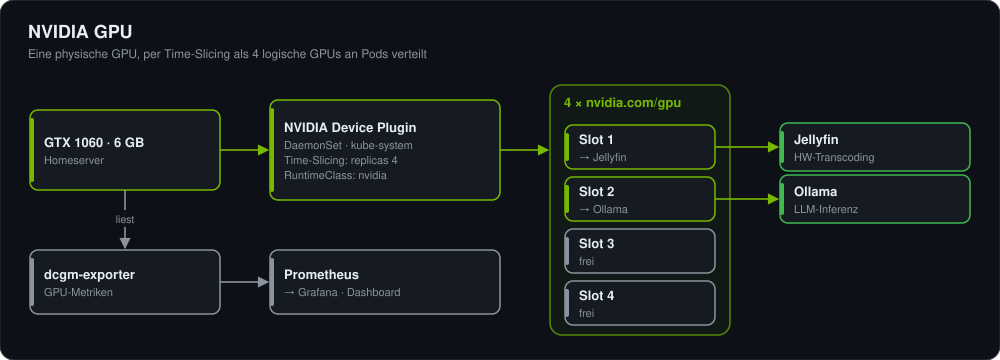</p>

Der **NVIDIA Device Plugin** teilt die GTX 1060 per **Time-Slicing** in 4 logische GPUs
(`nvidia.com/gpu`). Jellyfin und Ollama fordern je eine an und laufen mit `runtimeClassName: nvidia`.
Der **dcgm-exporter** liefert die GPU-Werte an Prometheus.

> Time-Slicing teilt nur die Rechenzeit – die **6 GB VRAM** teilen sich alle Pods. Transcoding und
> ein grosses Modell gleichzeitig können den Speicher füllen.

### Secrets

Secrets liegen **nicht** im Repo. Sie werden einmalig von Hand angelegt (ArgoCD synct keine Secrets):

| Secret | Namespace | Keys |
| --- | --- | --- |
| `grafana-secrets` | `monitoring` | `admin-password` |
| `nextcloud-secrets` | `nextcloud` | `mariadb-root-password`, `mariadb-password` |
| `librechat-secrets` | `jarvis` | `jwt-secret`, `jwt-refresh-secret`, `creds-key`, `creds-iv`, `meili-master-key` |
| `pterodactyl-secrets` | `gaming` | `app-key`, `mariadb-root-password`, `mariadb-password`, `admin-password` |
| `plex-claim` | `media` | `token` (von [plex.tv/claim](https://www.plex.tv/claim), nur 4 Minuten gültig) |
| `ghcr-pull` | `bethegoat` | Pull-Secret für das private Image in GHCR (Typ `docker-registry`) |

<details>
<summary><b>Befehle zum Anlegen</b></summary>

```bash
pw() { openssl rand -base64 24; }

kubectl create secret generic grafana-secrets -n monitoring \
  --from-literal=admin-password="$(pw)"

kubectl create secret generic nextcloud-secrets -n nextcloud \
  --from-literal=mariadb-root-password="$(pw)" \
  --from-literal=mariadb-password="$(pw)"

kubectl create secret generic librechat-secrets -n jarvis \
  --from-literal=jwt-secret="$(openssl rand -hex 32)" \
  --from-literal=jwt-refresh-secret="$(openssl rand -hex 32)" \
  --from-literal=creds-key="$(openssl rand -hex 32)" \
  --from-literal=creds-iv="$(openssl rand -hex 16)" \
  --from-literal=meili-master-key="$(openssl rand -hex 32)"

kubectl create secret generic pterodactyl-secrets -n gaming \
  --from-literal=app-key="base64:$(openssl rand -base64 32)" \
  --from-literal=mariadb-root-password="$(pw)" \
  --from-literal=mariadb-password="$(pw)" \
  --from-literal=admin-password="$(pw)"

kubectl create secret generic plex-claim -n media \
  --from-literal=token="claim-XXXXXXXX"

# GitHub → Settings → Developer settings → Personal access tokens (classic), nur Scope read:packages
kubectl create secret docker-registry ghcr-pull -n bethegoat \
  --docker-server=ghcr.io --docker-username=JanikHenz --docker-password="ghp_XXXXXXXX"
```

> Datenbank-Passwörter nur bei der **ersten** Installation setzen – eine bestehende Datenbank
> übernimmt ein neues Passwort nicht automatisch.

</details>

---

## Netzwerk & Ports

Alle Weboberflächen sind über `https://<name>.janikhenz.ch` erreichbar (Cloudflare → Traefik).
Einen **NodePort** (direkt per `192.168.1.9:<port>` im Heimnetz) haben nur Dienste, die ihn wirklich
brauchen – der Grund steht jeweils als Kommentar im Service.

### Externe URLs

| URL | App | URL | App |
| --- | --- | --- | --- |
| `janikhenz.ch` | Dashboard | `chat.janikhenz.ch` | LibreChat |
| `argocd.janikhenz.ch` | ArgoCD | `ollama.janikhenz.ch` | Ollama |
| `jellyfin.janikhenz.ch` | Jellyfin | `grafana.janikhenz.ch` | Grafana |
| `plex.janikhenz.ch` | Plex | `prometheus.janikhenz.ch` | Prometheus |
| `jellyseerr.janikhenz.ch` | Jellyseerr | `homeassistant.janikhenz.ch` | Home Assistant |
| `sonarr.janikhenz.ch` | Sonarr | `nextcloud.janikhenz.ch` | Nextcloud |
| `radarr.janikhenz.ch` | Radarr | `vault.janikhenz.ch` | Vaultwarden |
| `prowlarr.janikhenz.ch` | Prowlarr | `syncthing.janikhenz.ch` | Syncthing |
| `qbt.janikhenz.ch` | qBittorrent | `pterodactyl.janikhenz.ch` · `wings.janikhenz.ch` | Pterodactyl |
| `bethegoat.janikhenz.ch` | BeTheGoat | | |

### NodePorts (Homeserver `192.168.1.9`)

| Port | Service | Wer nutzt ihn |
| --- | --- | --- |
| 30001 | Jellyfin | TV-Apps im Heimnetz |
| 30002 | Plex | TV-Apps im Heimnetz |
| 30008 TCP/UDP | qBittorrent-Torrent | Torrent-Peers (kein HTTP, daher nicht über Traefik) |
| 30009 | Home Assistant | Companion-App im Heimnetz |
| 30013 | Ollama | Home Assistant (Konversation) |
| 30014 | Whisper | Home Assistant (Wyoming, Spracherkennung) |
| 30015 | Piper | Home Assistant (Wyoming, Sprachausgabe) |
| 30020 | Pterodactyl Panel | Wings (läuft im Host-Netzwerk) |
| 30200 TCP/UDP · 30227 UDP | Syncthing | Geräte-Sync und Discovery |

### Interne Dienste (nur im Cluster)

| Service | Port | Genutzt von |
| --- | --- | --- |
| `flaresolverr-service.media` | 8191 | Prowlarr |
| `librechat-mongodb.jarvis` | 27017 | LibreChat |
| `librechat-meilisearch.jarvis` | 7700 | LibreChat |
| `chromadb-service.jarvis` | 8000 | – |
| `node-exporter.monitoring` | 9100 | Prometheus |
| `dcgm-exporter.monitoring` | 9400 | Prometheus |

---

## Betrieb

| Ich will … | So geht's |
| --- | --- |
| eine App ändern | Manifest ändern → Commit + Push. ArgoCD wendet es innerhalb von ~3 Minuten an. |
| etwas im Cluster von Hand ändern | Geht nicht dauerhaft – ArgoCD setzt es zurück (selfHeal). Änderungen immer über Git. |
| eine App stoppen | Im Dashboard auf 0 skalieren. Bleibt so, auch nach einem Sync. |
| Speicher / Namespaces ändern | `infrastructure/values.yaml` ändern → Push → Application `infrastructure` von Hand syncen, **ohne Prune**. |
| ArgoCD aktualisieren | `targetRevision` in `apps/argocd.yaml` erhöhen → Push → Diff prüfen → von Hand syncen. Kein `helm upgrade` mehr. |
| eine Application löschen | Bei `infrastructure` und `argocd` **immer „Non-cascading“** wählen. Bei App-Applications löscht ArgoCD nur die Kachel, nicht die Workloads. |
| ein neues Secret | Mit `kubectl create secret` anlegen, siehe [Secrets](#secrets). |
| die Prometheus-Konfiguration ändern | `prometheus-config.yaml` ändern **und** `checksum/config` in `prometheus-deployment.yaml` anpassen (`sha256sum` der neuen `prometheus.yml`, erste 12 Zeichen) – sonst lädt Prometheus die Änderung nicht. |
| ein Grafana-Dashboard hinzufügen | JSON von grafana.com als ConfigMap `grafana-dashboard-<name>.yaml` anlegen (`__inputs` entfernen, Datasource → `Prometheus`) und im `projected`-Volume in `grafana-deployment.yaml` eintragen. |

---

## Screenshots

### ArgoCD

<table>
  <tr>
    <td width="50%">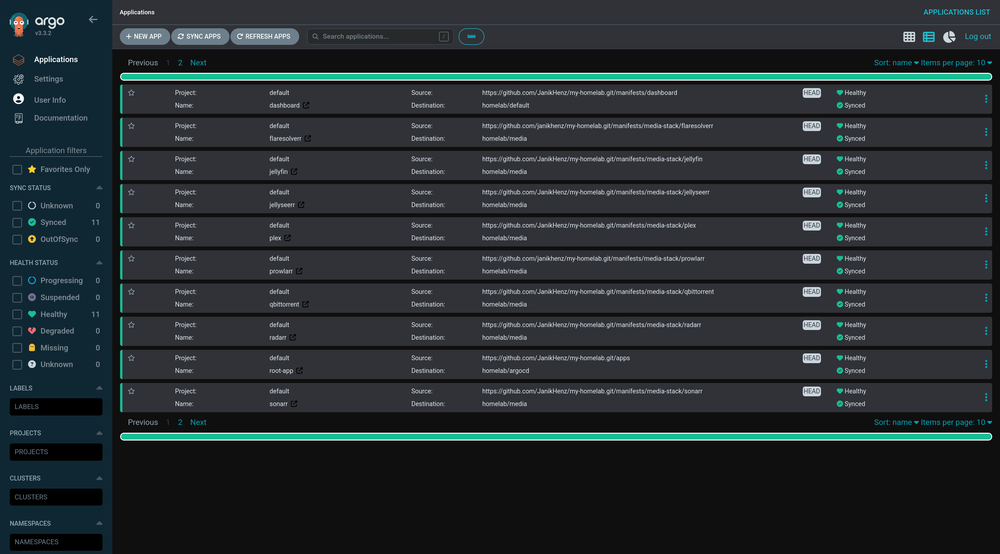</td>
    <td width="50%">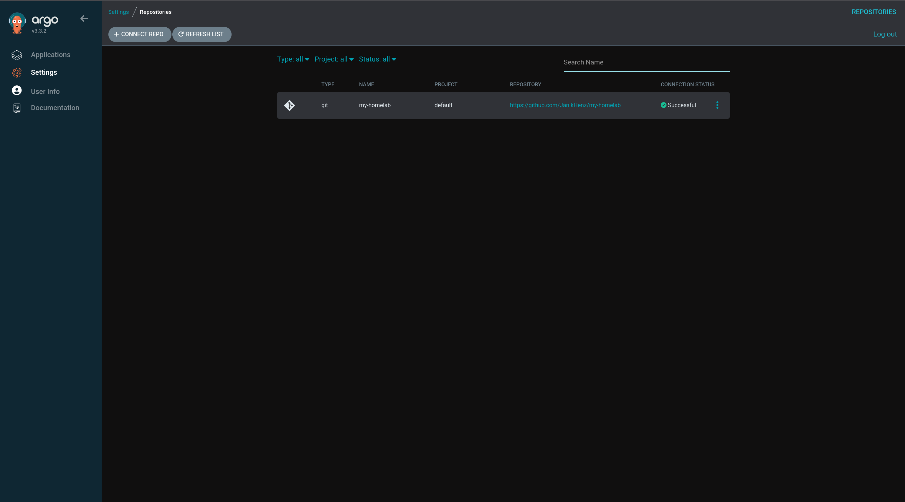</td>
  </tr>
  <tr><td align="center">Übersicht</td><td align="center">Repositories</td></tr>
</table>

### Kubernetes

<table>
  <tr>
    <td width="50%">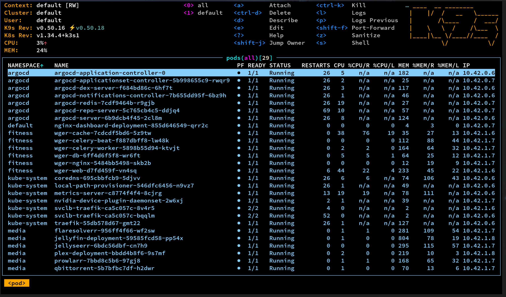</td>
    <td width="50%">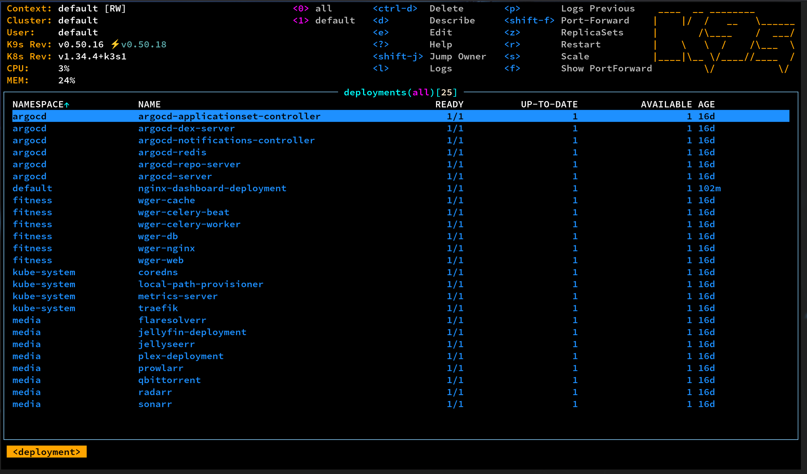</td>
  </tr>
  <tr><td align="center">Pods</td><td align="center">Deployments</td></tr>
  <tr>
    <td>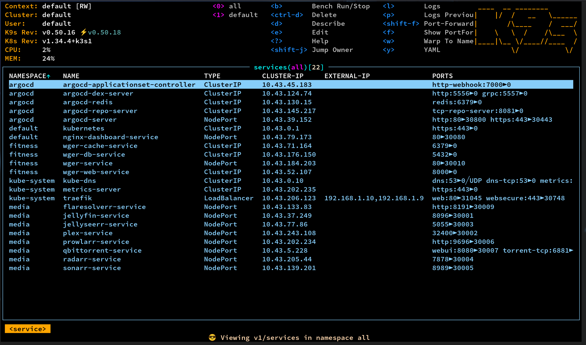</td>
    <td>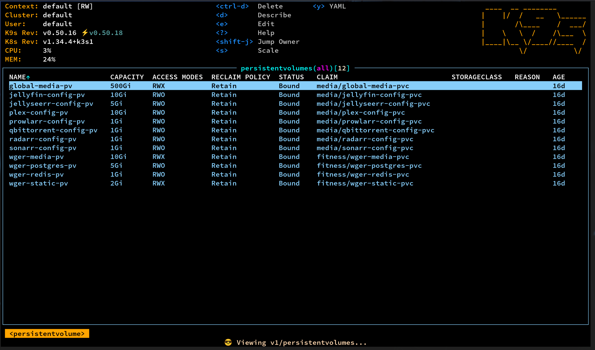</td>
  </tr>
  <tr><td align="center">Services</td><td align="center">PersistentVolumes</td></tr>
  <tr>
    <td>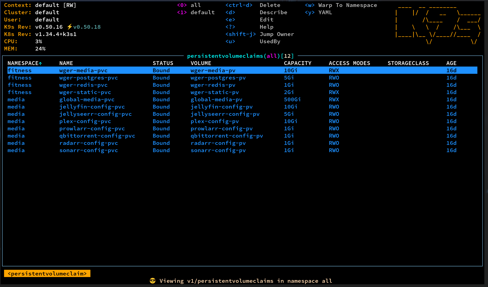</td>
    <td>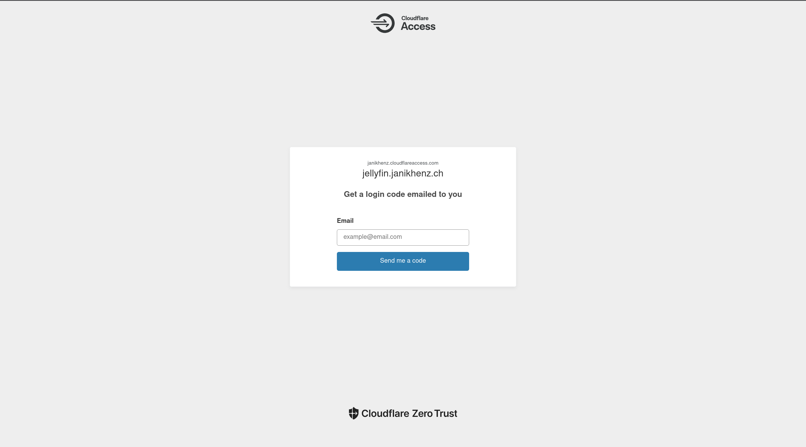</td>
  </tr>
  <tr><td align="center">PersistentVolumeClaims</td><td align="center">Cloudflare Zero Trust</td></tr>
</table>

### Apps

<table>
  <tr>
    <td width="33%">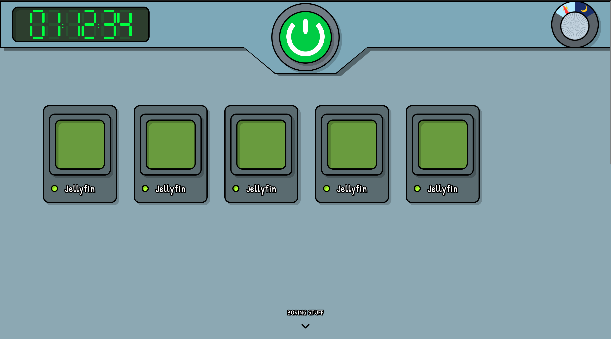</td>
    <td width="33%"></td>
    <td width="33%"></td>
  </tr>
  <tr><td align="center">Dashboard</td><td align="center">Jellyfin</td><td align="center">Plex</td></tr>
</table>

---

## Verzeichnisstruktur

```
my-homelab/
├── bootstrap/
│   └── root-app.yaml            # App of Apps – einziges Objekt, das von Hand angelegt wird
├── apps/                        # verwaltet von der root-app
│   ├── projects.yaml            # AppProjects: infrastructure, platform, apps
│   ├── applicationset.yaml      # erzeugt die 22 App-Applications (Liste)
│   ├── infrastructure.yaml      # Application für infrastructure/ (manueller Sync)
│   └── argocd.yaml              # ArgoCD verwaltet sich selbst (manueller Sync)
├── infrastructure/              # Helm-Chart: clusterweite Ressourcen
│   ├── Chart.yaml
│   ├── values.yaml              # Namespaces + Volumes als Liste
│   └── templates/               # namespaces, storage, nvidia-*
├── manifests/                   # ein Ordner pro App
│   ├── argocd/                  # IngressRoute für ArgoCD
│   ├── dashboard/
│   ├── gaming/pterodactyl/
│   ├── home-assistant/
│   ├── jarvis/                  # chromadb, librechat, ollama, piper, whisper
│   ├── media-stack/             # flaresolverr, jellyfin, jellyseerr, plex, prowlarr, qbittorrent, radarr, sonarr
│   ├── monitoring/
│   ├── nextcloud/
│   ├── bethegoat/               # Lern-Hub (Image aus dem Repo BeTheGoat)
│   ├── pwd-manager/             # Vaultwarden
│   └── syncthing/
└── docs/                        # Doku-Website (rendert diese README) + Bilder
    ├── index.html
    ├── css/ · js/
    └── img/                     # Diagramme (SVG) und Screenshots
```

---

## TODO

- [ ] Ollama-Modell verbessern
- [ ] Pi-hole in Kubernetes betreiben und in GitOps aufnehmen
- [ ] Eigene Fitness/Tracking-App
- [ ] Secrets verschlüsselt im Repo (Sealed Secrets oder SOPS)
- [ ] Image-Versionen festschreiben, Updates per Renovate
